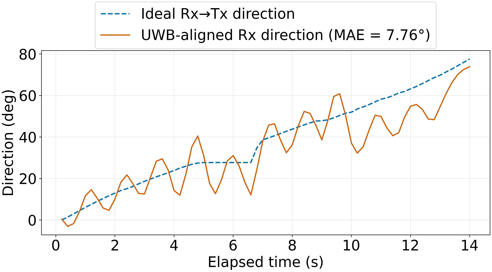
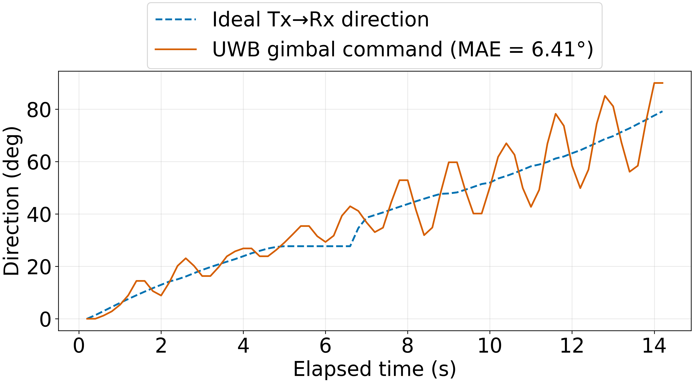

# 1m02 Dynamic Tracking Analysis

## 분석 범위

- Rover log: `1m02_arc_chrony_test_vel_log_20260730_062245.csv`
- Rx log: `rx.csv`
- Tx log: `1m02tx.csv`
- Rover time range: `0.100`–`14.201` s
- 분석 기준: 로버 기록 시간 범위 안의 표본만 사용

## 1. 빨간색 인식률

| 전체 주기 | 인식 성공 | 색상 미검출 | 카메라 타임아웃 | UWB 미수신 | 기타 오류 | 시스템 전체 인식률 | 정상 처리 조건 인식률 |
|---:|---:|---:|---:|---:|---:|---:|---:|
| 70 | 70 (100.0%) | 0 (0.0%) | 0 (0.0%) | 0 (0.0%) | 0 (0.0%) | 100.0% | 100.0% |

`sample_index=0` 초기화 행은 제외하고 로버 시간 범위 안의 70개 주기를
전체 분모로 사용했다. 시스템 전체 인식률은 모든 실패 원인을 포함하며, 정상
처리 조건 인식률은 UWB 수신과 카메라 프레임 획득 후 실제 색상 판정까지
진행된 `인식 성공 + 색상 미검출` 주기만 분모로 사용했다.

## 2. Rx 방향 추종

로버 운행 시간 안의 유효 Rx 명령 70개를 비교했으며, 이상적 방향은 분석 구간에서 +77.6° 변화하고 명령 기반 정렬 방향은 +73.5° 변화했다.
두 선 사이의 평균 절대 방향 오차(MAE)는 7.76°이고 최대 절대 차이는 21.29°로 나타났다. 이 값은 엔코더 실측각이 아니라 UWB 기반 짐벌 명령으로
계산한 정렬 방향을 기준으로 한다.

## 3. Tx 방향 추종

로버 운행 시간 안의 유효 Tx 명령 71개를 비교했으며, 이상적 방향은 분석 구간에서 +79.2° 변화하고 명령 기반 정렬 방향은 +90.0° 변화했다.
두 선 사이의 평균 절대 방향 오차(MAE)는 6.41°이고 최대 절대 차이는 17.05°로 나타났다. `gimbal_command_ros_deg`는 물리적 실측각이 아니라 실제
적용된 짐벌 명령값이다.

## 해석 시 주의사항

- Rx와 Tx의 정렬 방향은 엔코더 측정값이 아니라 실제 적용된 짐벌 명령을
  좌표계에 맞게 변환한 값이다.
- 분석은 로버 로그의 시간 범위로 제한했다.
