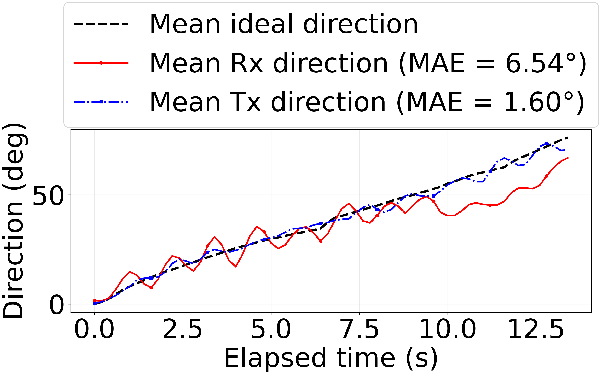
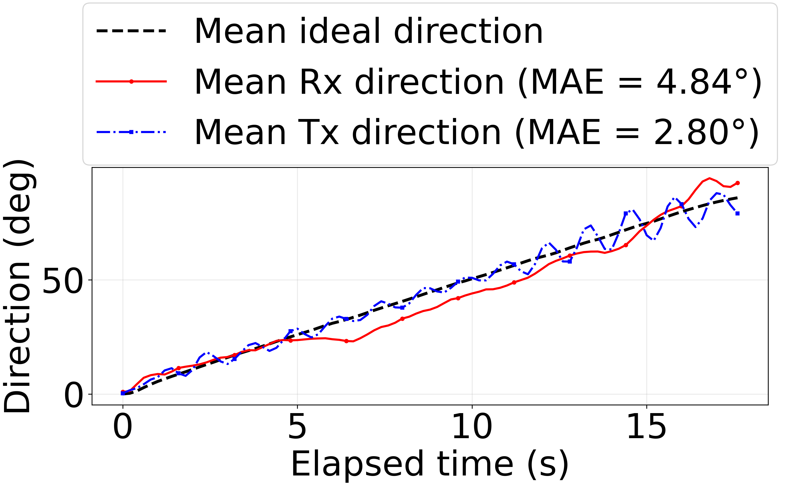
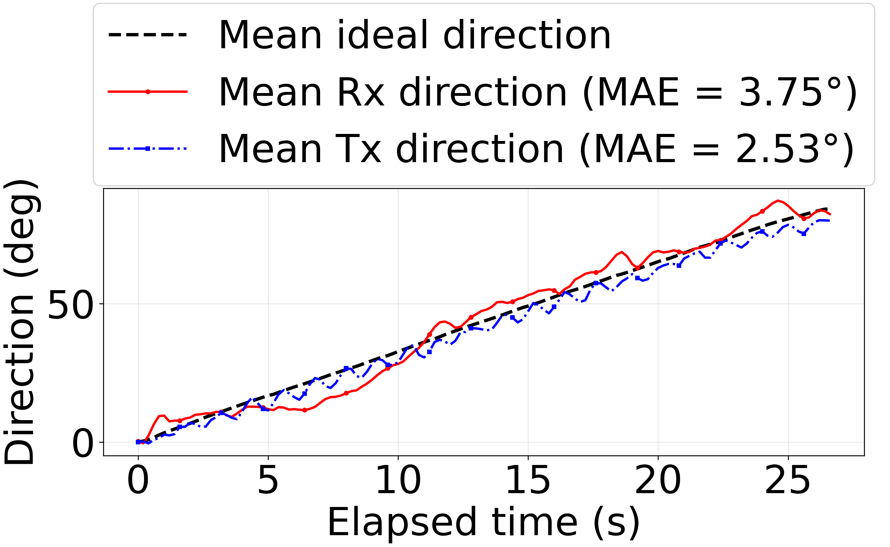

# Dynamic Tracking 거리별 상위 3회 합산 분석

## 선정 및 합산 방법

거리별 01–05 실행을 모두 같은 평가법으로 재계산한 뒤, 인식률은 선정에 사용하지 않고 `(Rx MAE + Tx MAE) / 2`가 낮은 순서로 세 실행을 선정했다.

선정된 세 실행은 각 로버 시작시각을 기준으로 상대시간을 맞췄다. 세 실행 모두 데이터가 존재하는 공통 시간 교집합에서 0.2초 간격으로 각 방향을 선형 보간하고, 각 시각의 Ideal·Rx·Tx 방향을 각각 더한 뒤 3으로 나눈 산술평균 시계열을 그렸다.

## 선정 결과

| Distance | Selected | Excluded |
|---:|---|---|
| 1 m | 1m01, 1m02, 1m05 | 1m03, 1m04 |
| 2 m | 2m01, 2m03, 2m04 | 2m02, 2m05 |
| 3 m | 3m01, 3m02, 3m03 | 3m04, 3m05 |

## 합산 지표

| Distance | Runs | N | Success | Color misses | Camera timeouts | Overall rate | Conditional rate | Mean time n | Mean Rx MAE | Mean Tx MAE |
|---:|---:|---:|---:|---:|---:|---:|---:|---:|---:|---:|
| 1 m | 3 | 243 | 241 | 0 | 2 | 99.18% | 100.00% | 68 | 6.54° | 1.60° |
| 2 m | 3 | 294 | 292 | 1 | 1 | 99.32% | 99.66% | 89 | 4.84° | 2.80° |
| 3 m | 3 | 411 | 251 | 153 | 7 | 61.07% | 62.13% | 134 | 3.75° | 2.53° |

## 거리별 Rx·Tx 통합 그래프

### 1 m

### 2 m

### 3 m

## 해석 시 주의사항

- 상위 실행 선택은 논문 결과를 유리하게 만들 수 있는 선택 편향을 유발하므로 선정 규칙과 제외 실행을 함께 공개해야 한다.
- 평균 그래프는 세 실행의 공통 시간 구간만 사용하므로 더 길게 지속된 실행의 후반부는 포함하지 않는다.
- 그래프 MAE는 시간별 평균 방향과 시간별 평균 Ideal 방향의 차이이며, 실행별 MAE의 단순평균이나 전체 원시 오차의 pooled MAE가 아니다.
- Rx·Tx 방향은 엔코더 실측 자세가 아니라 실제 적용된 짐벌 명령 기반 방향이다.
