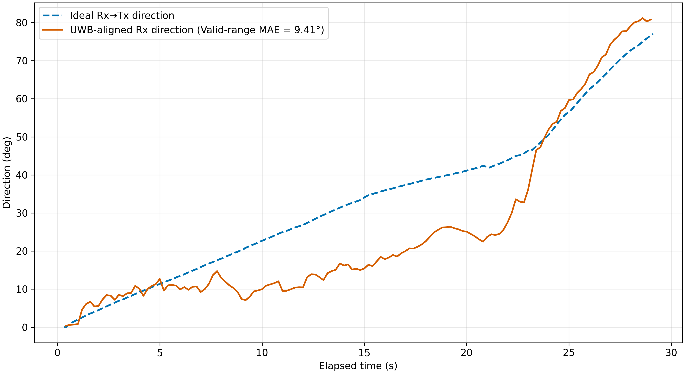
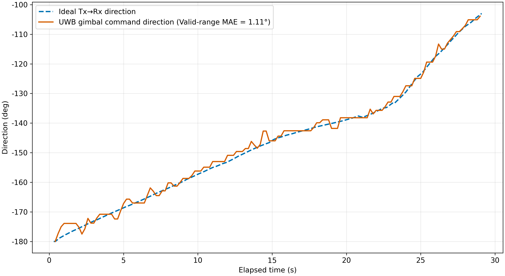

# random05 Random Path Dynamic Tracking Analysis

## 분석 범위

- Rover log: `random05_arc_random_z_maker_chrony_exp_log_20260801_223325.csv`
- Rx log: `rx.csv`
- Tx log: `random05tx.csv`
- Rover time range: `0.303`–`29.102` s
- Gimbal command range: `-90°–+90°`
- Tx coordinate mode: `absolute`

## 1. 빨간색 인식률

| 분석 범위 | 평가 주기 | 인식 성공 | 색상 미검출 | 카메라 타임아웃 | UWB 미수신 | 기타 오류 | 시스템 전체 인식률 | 정상 처리 조건 인식률 |
|---|---:|---:|---:|---:|---:|---:|---:|---:|
| 전체 구간 | 144 (100.0%) | 144 (100.0%) | 0 (0.0%) | 0 (0.0%) | 0 (0.0%) | 0 (0.0%) | 100.0% | 100.0% |
| 정렬 가능 구간 | 144 (100.0%) | 144 (100.0%) | 0 (0.0%) | 0 (0.0%) | 0 (0.0%) | 0 (0.0%) | 100.0% | 100.0% |
| 범위 초과 구간 | 0 (0.0%) | 0 (N/A) | 0 (N/A) | 0 (N/A) | 0 (N/A) | 0 (N/A) | N/A | N/A |

로버 시간 범위 안의 전체 빨간색 평가 주기는 144개이며, Rx 이상적 요구각이 짐벌 범위를 벗어난 주기는 0개였다. 따라서 전체 구간과 정렬 가능 구간의 인식률은 동일하다.

## 2. Rx 방향 추종

유효 Rx 명령 144개 중 정렬 가능 명령은 144개이고
범위 초과로 제외한 명령은 0개(0.0%)다.
정렬 가능 구간의 평균 절대 방향 오차(MAE)는
9.41°이며, 이상적 요구각은 범위 안이지만
`servo_clipped=1`인 명령은 17개로 MAE에 포함했다.
정렬 방향은 엔코더 실측각이 아니라 UWB 기반 짐벌 명령으로 계산한 방향이다.

## 3. Tx 방향 추종

유효 Tx 명령 144개 중 정렬 가능 명령은 144개이고
범위 초과로 제외한 명령은 0개(0.0%)다.
정렬 가능 구간의 평균 절대 방향 오차(MAE)는
1.11°이며, 이상적 요구각은 범위 안이지만
`servo_clipped=1`인 명령은 0개로 MAE에 포함했다.
Tx 방향도 엔코더 실측각이 아니라 실제 적용된 짐벌 명령 기반 방향이다.

## 해석 시 주의사항

- 회색 음영은 이상적 요구각이 짐벌 가동 범위를 벗어나 MAE에서 제외한 시간이다.
- 시간축은 범위 초과 시간을 제거하지 않은 실제 로버 경과시간이다.
- 정렬 방향은 엔코더 실측이 아니라 실제 적용된 짐벌 명령 기반 방향이다.
