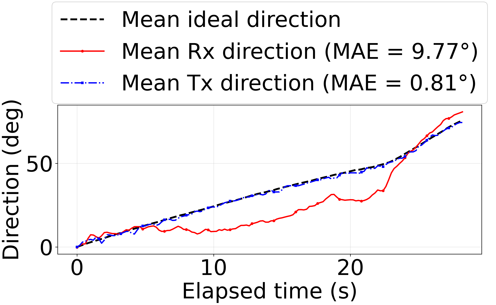

# Random Dynamic Tracking 상위 3회 합산 분석

## 선정 및 합산 방법

random01–05를 같은 평가법으로 재계산하고, 거리별 상위 3회 분석과 동일하게 인식률은 선정에 사용하지 않았다. `(Rx MAE + Tx MAE) / 2`가 낮은 순서로 세 실행을 선정했다.

선정된 세 실행은 로버 시작시각 기준 상대시간으로 맞추고, 세 실행 모두 데이터가 존재하는 공통 구간을 0.2초 간격으로 보간했다. Tx→Rx 방향은 180° 회전하여 Rx→Tx와 동일한 공통 방향 좌표계로 변환한 뒤 평균했다.

## 선정 결과

- Selected: random05, random01, random03
- Excluded: random04, random02

| Rank | Experiment | Overall rate | Rx MAE | Tx MAE | Mean Rx/Tx MAE |
|---:|---|---:|---:|---:|---:|
| 1 | random05 | 100.00% | 9.41° | 1.11° | 5.26° |
| 2 | random01 | 96.58% | 9.02° | 2.30° | 5.66° |
| 3 | random03 | 100.00% | 11.20° | 1.05° | 6.12° |
| 4 | random04 | 92.31% | 9.34° | 3.17° | 6.26° |
| 5 | random02 | 47.95% | 10.00° | 5.04° | 7.52° |

## 합산 지표

| Runs | N | Success | Color misses | Camera timeouts | Overall rate | Conditional rate | Pooled Rx n/MAE | Pooled Tx n/MAE | Mean time n | Mean-trajectory Rx MAE | Mean-trajectory Tx MAE |
|---:|---:|---:|---:|---:|---:|---:|---:|---:|---:|---:|---:|
| 3 | 433 | 428 | 0 | 5 | 98.85% | 100.00% | 433/9.87° | 433/1.49° | 142 | 9.77° | 0.81° |

## Rx·Tx 통합 그래프

## 해석 시 주의사항

- 상위 실행 선택은 선택 편향을 유발할 수 있으므로 선정 규칙과 제외 실행을 함께 공개한다.
- 인식률은 선정 기준이 아니다. 수동 검수 확정표가 있는 실행은 해당 표를 우선하고, 나머지는 Rx CSV 상태의 원시 건수를 합산했다.
- 그래프 MAE는 평균 방향 시계열과 평균 Ideal 시계열 사이의 MAE다. 원시 오차를 합친 pooled MAE는 표에 별도로 기록했다.
- Rx·Tx 방향은 엔코더 실측 자세가 아니라 실제 적용된 짐벌 명령 기반 방향이다.
