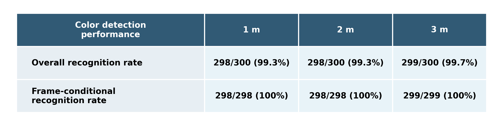

# 빨간색 인식 사전검사 통합 분석

## 분석 범위

- 실행 날짜: `20260801`
- 분석 실행: 9개(거리별 3개)
- 실행당 시도: 100회
- 전체 시도: 900회
- 제외 데이터: 매칭되는 날짜가 아닌 기존 실행

### 1 m
- `result/red_detection_precheck/run_20260801_181305_distance_1m_crop_0.6/red_detection_results.csv`
- `result/red_detection_precheck/run_20260801_181324_distance_1m_crop_0.6/red_detection_results.csv`
- `result/red_detection_precheck/run_20260801_181342_distance_1m_crop_0.6/red_detection_results.csv`

### 2 m
- `result/red_detection_precheck/run_20260801_181127_distance_2m_crop_0.6/red_detection_results.csv`
- `result/red_detection_precheck/run_20260801_181145_distance_2m_crop_0.6/red_detection_results.csv`
- `result/red_detection_precheck/run_20260801_181202_distance_2m_crop_0.6/red_detection_results.csv`

### 3 m
- `result/red_detection_precheck/run_20260801_180750_distance_3m_crop_0.6/red_detection_results.csv`
- `result/red_detection_precheck/run_20260801_180808_distance_3m_crop_0.6/red_detection_results.csv`
- `result/red_detection_precheck/run_20260801_180826_distance_3m_crop_0.6/red_detection_results.csv`

## 입력 검증

- 모든 실행에 `attempt=1..100`이 중복과 누락 없이 존재했다.
- 모든 행의 대상 색상은 `red`였다.
- 모든 상태는 `success`, `color_not_detected`,
  `camera_frame_timeout` 중 하나였다.
- 거리별 실행 수는 정확히 3개이며 거리별 합산 분모는 300회다.
- 9개 실행의 기록된 검출 설정은 다음과 같이 일치했다.

| 설정 | 값 |
|---|---:|
| `crop_scale` | 0.6 |
| `interval_s` | 0.2 |
| `color_min_area_px` | 125 |
| `color_min_component_area_px` | 50 |
| `red_saturation_min` | 130 |
| `red_value_min` | 110 |

카메라 장치 번호, 워밍업 시간, 조명 및 표식 자세는 현재 CSV에 기록되지 않으므로
파일만으로 재검증할 수 없다. 이 항목들은 동일하게 유지했다는 실험자의 조건을
전제로 한다.

## 실행별 결과

| Distance (m) | Replicate | Run | Total | Success | Color misses | Camera timeouts | Overall rate | Frame-conditional rate |
|---:|---:|---|---:|---:|---:|---:|---:|---:|
| 1 | 1 | `run_20260801_181305_distance_1m_crop_0.6` | 100 | 98 | 0 | 2 | 98.0% | 100.0% |
| 1 | 2 | `run_20260801_181324_distance_1m_crop_0.6` | 100 | 100 | 0 | 0 | 100.0% | 100.0% |
| 1 | 3 | `run_20260801_181342_distance_1m_crop_0.6` | 100 | 100 | 0 | 0 | 100.0% | 100.0% |
| 2 | 1 | `run_20260801_181127_distance_2m_crop_0.6` | 100 | 100 | 0 | 0 | 100.0% | 100.0% |
| 2 | 2 | `run_20260801_181145_distance_2m_crop_0.6` | 100 | 100 | 0 | 0 | 100.0% | 100.0% |
| 2 | 3 | `run_20260801_181202_distance_2m_crop_0.6` | 100 | 98 | 0 | 2 | 98.0% | 100.0% |
| 3 | 1 | `run_20260801_180750_distance_3m_crop_0.6` | 100 | 100 | 0 | 0 | 100.0% | 100.0% |
| 3 | 2 | `run_20260801_180808_distance_3m_crop_0.6` | 100 | 99 | 0 | 1 | 99.0% | 100.0% |
| 3 | 3 | `run_20260801_180826_distance_3m_crop_0.6` | 100 | 100 | 0 | 0 | 100.0% | 100.0% |

## 거리별 합산 결과

| Distance (m) | Total attempts | Successful detections | Color not detected | Camera frame timeouts | Overall recognition rate | Frame-conditional recognition rate |
|---:|---:|---:|---:|---:|---:|---:|
| 1 | 300 | 298 | 0 | 2 | 99.3% | 100.0% |
| 2 | 300 | 298 | 0 | 2 | 99.3% | 100.0% |
| 3 | 300 | 299 | 0 | 1 | 99.7% | 100.0% |

전체 인식률은 `S/N`, 프레임 조건부 인식률은 카메라 타임아웃을 제외한
`S/(S+C)`로 계산했다. 같은 거리의 세 실행은 백분율을 평균하지 않고 원시
건수를 먼저 합산했다.

## 논문용 표

## 결과 해석

새 카메라 프레임이 수신된 모든 회차에서 빨간색 표식이 검출되어 세 거리의 프레임 조건부 인식률이 모두 100.0%였다.

전체 인식률 감소에는 총 5회의 카메라 프레임 타임아웃이 포함되었다. 따라서 전체 인식률과 조건부 인식률의 차이는 색상 검출이 아니라 프레임 가용성의 영향을 나타낸다.

실패가 기록된 실행은 `run_20260801_181305_distance_1m_crop_0.6` 2회, `run_20260801_181202_distance_2m_crop_0.6` 2회, `run_20260801_180808_distance_3m_crop_0.6` 1회였다.

거리별 결과는 기본 빨간색 검출 성능과 카메라 프레임 가용성을 분리해 보여준다.
단, 세 거리의 촬영 시각과 물리적 환경이 완전히 동일했는지는 로그만으로 확인할
수 없으므로 관찰된 차이를 거리 자체의 직접적인 영향으로 단정하지 않는다.

## 정적 정렬 실험 해석에 사용하는 방법

프레임 조건부 인식률이 높다면 이후 정적 정렬 실험에서 발생하는
`color_not_detected`는 고정 표식에 대한 기본 검출 한계뿐 아니라 정렬 동작,
영상 획득 시점, 모션 블러 및 시야 내 표식 위치와 함께 해석해야 한다. 전체
인식률의 감소가 타임아웃에 의한 경우에는 색상 검출 실패와 구분해 보고한다.
